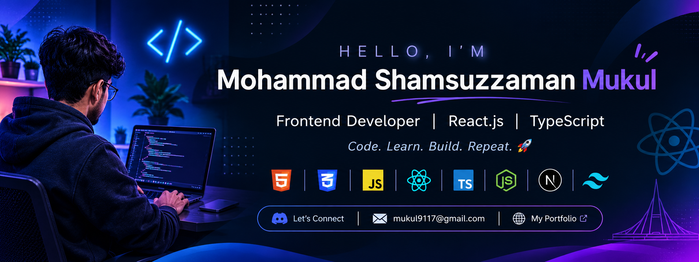

<!-- Profile Banner -->

  

<h1 align="center">Hi 👋, I'm Mohammad Shamsuzzaman Mukul</h1>

<h3 align="center">
  Frontend Developer | React.js | TypeScript
</h3>

  Passionate about building modern, responsive and user-friendly web applications.

---

## 👨‍💻 About Me

- 🔭 Currently working with **React.js & TypeScript** for frontend development.
- 🌱 Currently learning **Node.js & Next.js**.
- 💻 Interested in **Full-Stack Web Development**.
- 👨‍💻 Explore my projects: **[My Portfolio](https://gilded-treacle-a3ef0d.netlify.app)**
- 💬 Ask me about **React.js, JavaScript & TypeScript**.
- 📫 Reach me at **mukul9117@gmail.com**
- 🎯 Always learning, building and improving my development skills.

---

## 🚀 Technologies & Tools

### Frontend Development

  
  
  
  
  
  

### Backend & Learning

  
  

### Tools

  
  
  
  

---

## 🌐 Connect With Me

  
  

- 🌍 Portfolio: [Visit My Website](https://gilded-treacle-a3ef0d.netlify.app)
- 📧 Email: **mukul9117@gmail.com**

---

## 📊 GitHub Statistics

  

  

  

---

## 📈 Contribution Activity

  

---

<h3 align="center">✨ Code • Learn • Build • Repeat 🚀</h3>

  Thanks for visiting my GitHub Profile!

